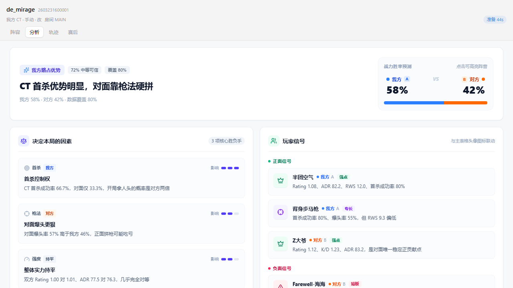
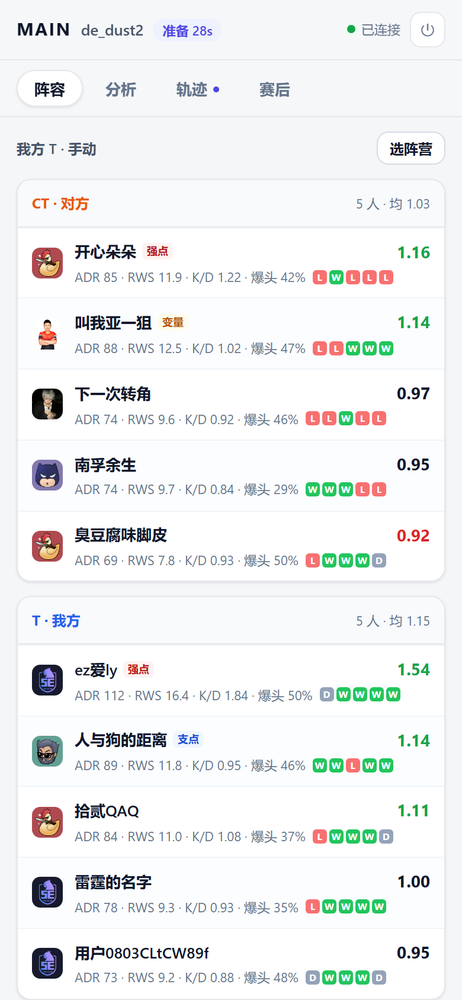
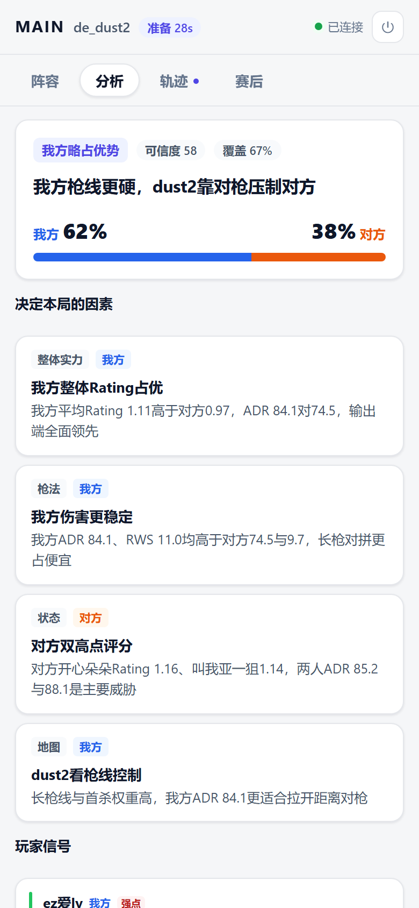
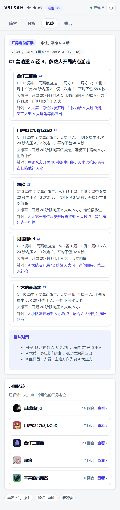

# CS Helper · 对局情报系统

[](https://github.com/QAQ-AWA/cs-helper-exe/actions/workflows/build-desktop.yml)
[](https://github.com/QAQ-AWA/cs-helper-android/actions/workflows/build.yml)
[](LICENSE)

CS2 车队用的**赛前情报**系统：电脑端侦测到对局 → 服务端拉取并解析对手历史 Demo →
队友手机上看阵容画像、开局轨迹和 AI 战术建议。

> **只做赛前历史数据**：不读游戏内存、不注入进程、不提供局内实时敌人位置。

<p align="center">
  
</p>

<p align="center">
  
  
  
</p>

## 能做什么

| 能力 | 说明 |
| --- | --- |
| **阵容画像** | 十个人的赛季 Rating / ADR / RWS / K/D / 爆头率 / 近 5 场，5E 数据缺失时用本场数据兜底并明说 |
| **对手开局轨迹** | 每人最近一场 Demo 的前 20 秒路径，雷达图回放，1x/2x/4x、按阵营筛选 |
| **AI 实力分析** | 结构化结论：胜率条、决定本局的因素、玩家信号、双方取胜路径、数据边界 |
| **AI 走位解读** | 每个人「实际怎么走 / 开局大概率在哪 / 怎么针对」+ 整队对策，直接挂在轨迹页 |
| **赛后复盘** | 比分、半场、双方 K/D/A 与 Rating、MVP/SVP，以及 AI 预判是否命中 |
| **多端同步** | 服务端是唯一权威，电脑和手机看到的永远是同一份状态 |

## 四个仓库

| 仓库 | 角色 |
| --- | --- |
| [**cs-helper**](https://github.com/QAQ-AWA/cs-helper) | **主仓库**：桌面端、服务端、解析引擎、契约、文档都在这里 |
| [**cs-helper-exe**](https://github.com/QAQ-AWA/cs-helper-exe) | **构建 + 发布**：同一份代码，Actions 在这里跑，安装包发到 `latest-build` |
| [**cs-test**](https://github.com/QAQ-AWA/cs-test) | **镜像**：同一份代码，构建只跑测试和产物，不发 Release |
| [**cs-helper-android**](https://github.com/QAQ-AWA/cs-helper-android) | **Android 客户端**：Flutter 实现，独立维护、独立发 APK |

三个 `cs-helper*` 仓库是同一份 `main` 的镜像，区别只在 CI 行为：

```bash
git push              # → cs-test（镜像）
git push helper main  # → cs-helper（主仓库）
git push exe main     # → cs-helper-exe（触发构建 + 发布）
```

## 架构

```
┌── desktop/ ─────────────────────────────────────────────────┐
│ Tauri v2 · Rust · Vue 3                                     │
│ 5E CDP 侦测 · 完美世界日志解析 · 就绪倒计时 · 本地展示        │
│ 只上报「看到了什么」，不下结论                                │
└───────────────┬─────────────────────────────────────────────┘
                │  HTTP 上报（幂等键 platform:matchId）· WS 订阅
┌───────────────▼── server/ ──────────────────────────────────┐
│ FastAPI · WebSocket                                         │
│ 房间中心 · 任务编排（按 matchId 去重）· 事件分发              │
│ 计算：engine/ 解析 Demo（异步子进程）· AI 编排（可选）        │
└───────────────┬─────────────────────────────────────────────┘
                │  WS
   📱 手机（PWA / 原生 Android）：阵容 · 轨迹 · AI · 赛后
```

服务端可以跑在本机，也可以部署到公网服务器让队友远程接入——
见 [docs/DEPLOY.md](docs/DEPLOY.md)（甲骨文 A1 / ARM64 实测通过）。

## 快速开始

### A. 只想用

1. 下载桌面端：<https://github.com/QAQ-AWA/cs-helper-exe/releases/tag/latest-build>
2. 下载手机端：<https://github.com/QAQ-AWA/cs-helper-android/releases>
3. 桌面端「设置 → 小队协同」填服务端地址和房间码，用二维码让队友扫码

### B. 自己跑服务端

```bash
python -m venv .venv
.venv/Scripts/activate            # Linux/macOS: source .venv/bin/activate
pip install -r server/requirements.txt
pip install -r engine/requirements.txt

export CS_HELPER_SERVER_SECRET='换成随机串'   # 不设则重启后 token 全部失效
python -m uvicorn app.main:app --host 0.0.0.0 --port 8787 --app-dir server
```

- 健康检查 `/healthz`，手机打开 `http://<IP>:8787/?room=<房间码>`
- 默认**单房间模式**（房间码就是门禁）；要多房间设 `CS_HELPER_ROOM_MODE=multi`
- AI 分析需要 `CS_HELPER_AI_KEY`（任何 OpenAI 兼容端点）；不填则跳过 AI，其它功能照常

### C. 部署到服务器

```bash
bash deploy/preflight.sh    # 先自检：依赖轮子、5E 接口、demo CDN 实测速度
sudo bash deploy/install.sh # 装成 systemd 服务，幂等可重复执行
```

细节、风险与排障见 [docs/DEPLOY.md](docs/DEPLOY.md)。

### D. 改代码

```bash
cd desktop && npm ci && npm run dev          # 桌面端（Tauri + Vite）
cd server  && pytest tests -q                # 服务端
cd engine  && pytest tests -q                # 解析引擎
python tools/smoke_e2e.py                    # 端到端冒烟（先起 8787）
```

## 目录

| 目录 | 内容 |
| --- | --- |
| [`desktop/`](desktop/) | 桌面客户端（Tauri v2 · Rust · Vue 3 · TS） |
| [`server/`](server/) | 房间与分发服务（FastAPI · WebSocket） |
| [`server/static/`](server/static/) | 手机端 PWA（原生 ESM · Canvas） |
| [`engine/`](engine/) | Demo 检索、下载、解析（Python · demoparser2） |
| [`contract/`](contract/) | 端云事件契约（与 `server/app/events.py` 互为镜像） |
| [`deploy/`](deploy/) | 一键部署脚本、systemd 单元、Caddy 反代 |
| [`tools/`](tools/) | 端到端冒烟脚本 |
| [`docs/`](docs/) | 架构、部署、交接、历程 |

## 验证现状

| 套件 | 命令 | 结果 |
| --- | --- | --- |
| 服务端 | `cd server && pytest tests -q` | **159 passed** |
| 引擎 | `cd engine && pytest tests -q` | **119 passed, 10 skipped**（缺 328MB 集成样本） |
| 桌面端 | `cd desktop && npm test` | **246 passed** |
| Android | `flutter analyze && flutter test` | 0 issue · 17 passed |
| 界面 | `npx playwright test`（本地 UI 验收） | 20 张截图 |

## 文档

| 文档 | 看它做什么 |
| --- | --- |
| [docs/architecture.md](docs/architecture.md) | 架构定位、拓扑、技术选型与取舍 |
| [docs/DEPLOY.md](docs/DEPLOY.md) | 部署到服务器：资源估算、风险、运维、排障 |
| [docs/HANDOFF.md](docs/HANDOFF.md) | 接手必读：现状、约定、踩坑清单、验收清单、待办 |
| [docs/HISTORY.md](docs/HISTORY.md) | 每一轮改了什么、为什么、实测数据 |
| [contract/events.json](contract/events.json) | 端云事件契约（漂移时测试失败） |

## 许可与致谢

MIT，见 [LICENSE](LICENSE)；第三方依赖见 [THIRD_PARTY_NOTICES.md](THIRD_PARTY_NOTICES.md)。

- 桌面客户端衍生自 [qianjiachun/cs-match-helper](https://github.com/qianjiachun/cs-match-helper)
- Demo 解析引擎来自 **CS-Scout 2.0**（EytleBB）
- 地图雷达图与变换来自 CS2 游戏文件

## 免责声明

仅用于赛前情报与赛后复盘。请勿用于破坏平台公平性的用途。
