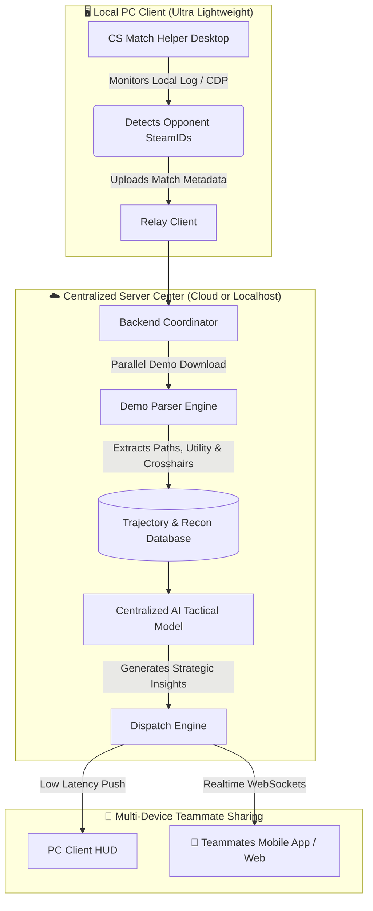

> **本目录是 CS Helper 的桌面端模块**，不是独立项目。
> 整体说明、服务端与手机端见[仓库根 README](../README.md)；
> 上游来源与改动范围见 [THIRD_PARTY_NOTICES.md](../THIRD_PARTY_NOTICES.md)。

<div align="center">

# 🎮 CS Match Helper

**An Intelligent Match Intelligence & Player Analytics Assistant for CS2**

Built with Tauri v2 + Vue 3 · Supports Perfect World & 5E Arena · Pre-Match Opponent Recon · 5E Post-Match Reports · AI Tactical Forecast

[English](README.md) · [简体中文](README.zh-CN.md)

<p>
  <a href="https://github.com/QAQ-AWA/cs-helper-exe/stargazers"></a>
  <a href="https://github.com/QAQ-AWA/cs-helper-exe/releases/latest"></a>
  
  
  <a href="LICENSE"></a>
</p>

### 📥 [【Download Latest cs-match-helper.exe】](https://github.com/QAQ-AWA/cs-helper-exe/releases/latest)

</div>

---

## 💡 Overview

**CS Match Helper** is a lightweight, clean, and portable desktop companion for Counter-Strike 2. During match warm-ups and ready phases, it captures both teams' historical records, recent forms, primary weaponry, premade party groups, and 5-axis combat radar charts, with optional LLM-driven pre-match AI tactical forecasting.

This fork refactors and elevates the original project:
- Fully integrated with **4.0.0 Architecture** and **AI Analysis V3**;
- Features an exclusive **5E Post-Match In-Depth Report**;
- **Completely removed third-party auto-update and CDN overwrite mechanisms**, packing all frontend assets directly into the standalone portable binary;
- Laid the groundwork to merge with a historical Demo trajectory analytics engine into a "Lightweight Desktop Probe + Central Server + Teammate Mobile Sync" architecture.

---

## 🌟 Key Features

### 1. ⚔️ Dual-Platform Instant Match Recon
- **Perfect World Arena**: Supports Perfect World App QR scan login and Steam direct login, reliably reading match room status, ladder ranks, and season badges.
- **5E Arena**: Leverages Chrome DevTools Protocol (CDP) for instantaneous room detection, team lineups, and combat ratings.

### 2. 📊 Comprehensive Player & Team Analytics
- **Premade Party Detection**: Instantly identifies duos, trios, and 5-man stacks.
- **5-Axis Radar Chart**: Compares Rating, K/D, Headshot percentage, First Kill effectiveness, and Win Rate.
- **Key Player Badging**: Highlights high-threat star fraggers, hot streaks, and tactical weak points.

### 3. 📑 Exclusive 5E Post-Match Analysis Report
- Automatically surfaces a comprehensive post-match dashboard ([`P5ePostMatchPanel.vue`](file:///i:/code项目/CS/src/mainview/components/P5ePostMatchPanel.vue)).
- Breaks down Rating trajectories, multi-kill rounds (1vX / 3K / 4K / ACE), entry duel success, grenade utility damage, and enemy flash duration.

### 4. 🤖 AI Matchup Analysis & Tactical Forecasting V3
- Compatible with mainstream LLM providers (OpenAI API format, DeepSeek, Google Gemini, Anthropic Claude, local Ollama, etc.).
- Evaluates map pool matchups and team dynamics to offer tailored opening strategies and counters.
- User API keys remain strictly stored on your local machine.

### 5. 🛡️ Clean, Standalone & Safe
- **True Standalone Portable**: All frontend static assets are bundled inside the Rust binary. No local Node/Vite development server required.
- **No Background Overwrite**: Stripped original CDN check logic to keep your client stable and self-contained.
- **VAC-Safe Compliance**: **Not a cheat**. Does not hook keyboard inputs, inject DLLs, read game memory, or modify game files. Uses official client APIs and local logs only.

---

## 🗺️ Architectural Roadmap

We are integrating this project with a historical demo trajectory parser to build an ultra-efficient team recon system:



### Highlights:
1. **Zero PC Overhead**: The desktop app acts merely as a lightweight probe, delegating heavy demo parsing and AI inference to a remote or dedicated server.
2. **Cost-Efficient**: In a 5-man stack, one probe reports match info; the server parses once and caches insights, preventing redundant API calls and Token costs.
3. **Team Sharing**: Teammates open a lightweight mobile app or web page to immediately view the opposing team's common positions and tactical advice.

---

## 🛠️ Development & Building

### Prerequisites
- **Node.js** >= 20
- **Rust** >= 1.78
- **OS**: Windows 10 / 11 (with Microsoft Edge WebView2)

### 1. Install Dependencies
```bash
npm ci
```

### 2. Start Local Dev Server
```bash
npm run dev
```

### 3. Run Unit Tests
```bash
npm test
```

### 4. Build Standalone Release Executable
```bash
npm run build:exe
```
The compiled binary will be placed at `src-tauri/target/release/cs-match-helper.exe`.

---

## ⚙️ CI/CD & Build Guidelines (Key Gotchas)

When maintaining and building desktop applications with Tauri v2 on GitHub Actions, the following lessons are critical to avoid silent build or runtime failures:

### 1. 🚨 Standalone Release Compilation: Always use `tauri build --no-bundle`
- **Issue**: Directly running raw `cargo build --release` in CI causes the resulting `.exe` to open with `ERR_CONNECTION_REFUSED - localhost refused to connect`.
- **Root Cause**: Tauri embeds runtime configuration via `tauri::generate_context!()` at compile time. Bypassing Tauri CLI and running `cargo` directly leaves `"devUrl": "http://localhost:5173"` intact from `tauri.conf.json`. The application treats the build as a development client and tries to connect to a local Vite dev server.
- **Solution**: Always build via `npm run build:exe` (which invokes `tauri build --no-bundle`). Tauri CLI runs `beforeBuildCommand` (`vite build`) to produce `dist/`, then **strips devUrl and bundles all static HTML/CSS/JS assets directly into the standalone binary** (~6.1 MB), ensuring zero-dependency offline execution.

### 2. 🌐 CI Runner UTC Timezone and Locale Pitfalls
- **Issue**: Unit tests pass locally but fail on GitHub Actions runners.
- **Timezone**: GitHub Actions runners operate in **UTC**. Tests asserting deadline calculations (e.g., [`ready-deadline.test.ts`](file:///i:/code项目/CS/src/platforms/perfect/ready-deadline.test.ts)) can trigger date rollback issues across midnight if timezone anchors are assumed to be UTC+8. Use explicit relative time anchors or deterministic mock dates.
- **Locale**: Runners default to `en-US`. If tests match specific Chinese strings (e.g., in [`useP5eCdp.test.ts`](file:///i:/code项目/CS/src/mainview/composables/useP5eCdp.test.ts)), explicitly call `applyResolvedLocale('zh-CN')` in the test setup.

### 3. 🧩 Tauri Capabilities Strict Manifest Sync
- **Issue**: `tauri-build` in `build.rs` panics during Cargo compilation.
- **Root Cause**: In Tauri v2, `.json` manifests in `src-tauri/capabilities/` are strictly validated against `src-tauri/permissions/*.toml`.
- **Solution**: Whenever pruning legacy features (such as counter-strafing or game bar HUD), immediately delete or update capability files that reference deleted permissions.

### 4. 🧵 Windows COM Object Thread Affinity (`!Send` in Rust)
- **Issue**: Rust fails to compile with `WebviewWindow cannot be sent between threads safely (the trait Send is not implemented)`.
- **Root Cause**: On Windows, WebView2 wraps `ICoreWebView2Controller`, which is a thread-affine COM object tied to the main UI thread.
- **Rule**: Never capture or move `WebviewWindow` into `std::thread::spawn`. Perform window manipulations on the main UI thread or dispatch updates via `app_handle.emit`.

### 5. 📦 GitHub Release Assets & CDN Caching
- **Issue**: Downloading from GitHub Releases immediately after a re-tag delivers the previous binary.
- **Cause**: Fastly/Varnish caches HTTP 302 redirects with an `Age` header.
- **Solution**: Use cache-busting headers or query strings (`curl -I "https://.../cs-match-helper.exe?cachebust=1"`) or press `Ctrl + F5` in your browser to verify the true `Last-Modified` and `Content-Length`.

---

## 📁 Repository Layout

```text
├── src/                          # Frontend source (Vue 3 + Tailwind CSS + TypeScript)
│   ├── core/                     # Core logic (AI, comments, match history, mapper)
│   ├── platforms/                # Platform adapters
│   │   ├── 5e/                   # 5E Arena (CDP probe, API signature, post-match panel)
│   │   └── perfect/              # Perfect World Arena (crypto, QR/Steam login, parser)
│   └── mainview/                 # Desktop UI (dashboard, comparison, 5E report)
├── src-tauri/                    # Rust backend (Tauri v2)
│   ├── src/
│   │   ├── lib.rs                # Tauri command registration & window lifecycle
│   │   ├── log_watcher.rs        # Console log streaming
│   │   ├── platform/             # Network proxies & CDP probes
│   │   ├── update.rs             # Safe version control (external update channel disabled)
│   │   └── ai.rs                 # Local AI configuration store
│   ├── capabilities/             # Tauri permissions & capabilities
│   └── tauri.conf.json           # Application config
├── .github/workflows/build.yml   # GitHub Actions CI/CD release workflow
└── package.json                  # Dependencies & scripts
```

---

## ⚖️ Disclaimer & Acknowledgements

- This tool is strictly intended for pre-match reference and post-match review. Do not use it for unfair competition or in violation of platform terms of service.
- Forked from the original open-source project by [qianjiachun/cs-match-helper](https://github.com/qianjiachun/cs-match-helper). Special thanks to Xiaochun for his invaluable contributions to the CS community.
- Maintained and expanded by [QAQ-AWA](https://github.com/QAQ-AWA).

---

## 📄 License

Licensed under the [MIT License](LICENSE).
