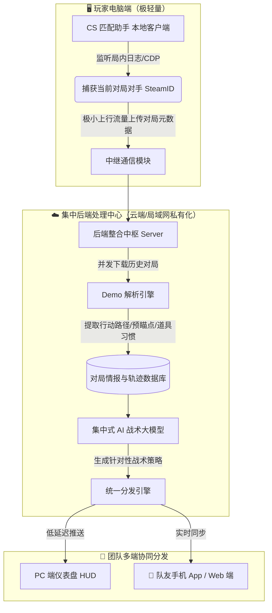

<div align="center">

# 🎮 CS 匹配助手 (CS Match Helper)

**专为 CS2 打造的智能对局情报分析与战力洞察工具**

基于 Tauri v2 + Vue 3 构建 · 支持完美世界与 5E 平台 · 赛前对手情报 · 5E 赛后深度战报 · AI 战术推演

[English](README.md) · [简体中文](README.zh-CN.md)

<p>
  <a href="https://github.com/QAQ-AWA/cs-helper-exe/stargazers"></a>
  <a href="https://github.com/QAQ-AWA/cs-helper-exe/releases/latest"></a>
  
  
  <a href="LICENSE"></a>
</p>

### 📥 [【立即下载最新发布版本 cs-match-helper.exe】](https://github.com/QAQ-AWA/cs-helper-exe/releases/latest)

</div>

---

## 💡 项目简介

**CS 匹配助手** 是一款绿色、独立的 CS2 对战情报辅助软件。在游戏匹配与准备阶段，软件能够毫秒级获取双方选手的历史战绩、近期状态、常用武器、组排开黑关系与五维雷达图，并可结合大语言模型进行 AI 战术分析与胜率预测。

本项目基于小淳原版开源代码进行深度重构与升级：
- 升级至 **4.0.0 架构** 与 **AI 分析 V3**；
- 独家集成 **5E 赛后深度报告** 功能；
- **彻底剔除原版远程自动更新与 CDN 覆盖逻辑**，前端静态资源全量内嵌打包，确保本地单文件便携运行，无后台静默篡改风险；
- 后续将与历史 Demo 轨迹分析项目整合，演进为“桌面轻量采集 + 云端集中分析 + 队友多端实时共享”的协同系统。

---

## 🌟 核心功能

### 1. ⚔️ 双平台毫秒级情报捕获
- **完美世界竞技平台**：支持完美通行证 App 扫码登录与 Steam 官方账号直接登录，精准读取匹配房间状态、分段与赛季战绩。
- **5E 竞技平台**：支持 CDP 协议与客户端联动，秒级捕获对局房间、双方阵容与天梯战力数据。

### 2. 📊 选手与队伍全景数据
- **组排关系侦测**：自动识别敌我双方开黑车队（双排、三排、五黑）。
- **五维战力雷达图**：综合展现 Rating、K/D、爆头率、首杀能力与综合胜率。
- **关键先生标记**：突出标注敌方绝活哥、状态火热选手及重点突破口。

### 3. 📑 独家 5E 赛后深度战报
- 比赛结束后自动生成整场对局深度分析面板（[`P5ePostMatchPanel.vue`](file:///i:/code项目/CS/src/mainview/components/P5ePostMatchPanel.vue)）。
- 提供详细的 Rating 趋势、多杀轮次（1vX / 3K / 4K / ACE）、首杀表现、投掷物造成伤害与致盲效率。

### 4. 🤖 AI 战力分析与战术推演 V3
- 兼容主流大模型协议（OpenAI 兼容接口、DeepSeek、Gemini、Claude、本地 Ollama 等）。
- 结合当前地图特性、双方近期攻防偏好与状态起伏，一键生成赛前分析、战术提醒与克制策略。
- 密钥完全由用户本地掌控，不经过任何第三方中转。

### 5. 🛡️ 纯净独立，安全无封号风险
- **绿色免安装**：全量前端静态页面直接内嵌至 Rust 编译的单文件 exe 中，开箱即用，无需配置任何本地 Node/Vite 服务。
- **剔除静默更新**：移除了原作者的 Lunaris CDN 自动检查与后台覆盖机制，版本完全受控。
- **绝对安全合规**：**非外挂**，不读取游戏内存，不注入 CS2 游戏进程，不拦截修改游戏封包，纯基于客户端合法本地日志与平台公开 API。

---

## 🗺️ 后续架构演进蓝图 (Roadmap)

我们正计划将本项目与“历史 Demo 行动轨迹分析”项目深度整合，打造低成本、高效率的团队战术协同体系：



### 蓝图优势：
1. **电脑零性能负担**：玩家电脑端仅作为轻量探针，所有沉重的 Demo 轨迹解析与 AI 推理全部交给服务器处理，游戏全程不掉帧。
2. **节省 API 与网络开销**：单场比赛 5 名队友只需由探针上报一次，服务器集中分析并缓存复用，避免多人重复调用平台接口与大模型 Token。
3. **队友多端共享**：队友手机只需下载轻量 App 或打开网页，就能实时同步对面的站位习惯、常架枪位与战术建议，实现一人运行、全队共享。

---

## 🛠️ 本地开发与构建

### 环境要求
- **Node.js** >= 20
- **Rust** >= 1.78
- **OS**：Windows 10 / 11（需具备 Microsoft Edge WebView2，Win11 自带）

### 1. 安装依赖
```bash
npm ci
```

### 2. 启动本地开发环境
```bash
npm run dev
```

### 3. 执行自动化测试
项目包含针对平台解析器、CDP 管道、加密签名与组件状态的完整测试套件：
```bash
npm test
```

### 4. 打包单文件可执行文件
使用 Tauri CLI 进行脱机独立打包（自动内嵌全部前端静态文件，剥离 devUrl）：
```bash
npm run build:exe
```
编译产物位于 `src-tauri/target/release/cs-match-helper.exe`。

---

## ⚙️ GitHub Actions CI/CD 与构建核心避坑指南

在维护与打包桌面端可执行程序时，以下经验至关重要，能避免 90% 的自动化编译与运行故障：

### 1. 🚨 独立可执行文件打包：必须使用 `tauri build --no-bundle`
- **故障现象**：若在 CI 或本地直接运行原生 `cargo build --release`，打包出的 exe 双击打开会报错：`无法访问此页面 - ERR_CONNECTION_REFUSED - localhost 拒绝连接`。
- **背后机理**：Tauri 通过宏 `tauri::generate_context!()` 在编译期嵌入配置。如果绕过 Tauri CLI 直接使用底层 `cargo` 编译，Tauri 无法激活生产模式，会保留 `tauri.conf.json` 中的 `"devUrl": "http://localhost:5173"`，导致打出来的客户端误认为处于开发模式并试图连接本地 Vite 服务。
- **正确姿势**：构建必须调用 `npm run build:exe`（底层执行 `tauri build --no-bundle`）。Tauri CLI 会自动执行 `beforeBuildCommand` (`vite build`) 生成 `dist/`，并在编译 Rust 时**彻底剔除 devUrl，将前端 HTML/CSS/JS 全量内嵌打包进 exe 二进制内部**（单文件体积约 6.1 MB），实现真正的开箱即用脱机运行。

### 2. 🌐 CI 自动化测试的 UTC 时区与 Locale 语言陷阱
- **故障现象**：本地运行 `npm test` 毫无问题，推送到 GitHub Actions 后单元测试报错退出。
- **时区差异**：GitHub 运行器默认位于 **UTC 时区**。涉及倒计时、就绪截止时间换算等测试（如 [`ready-deadline.test.ts`](file:///i:/code项目/CS/src/platforms/perfect/ready-deadline.test.ts)），若硬编码了固定日期或依赖当前系统午夜计算，会因时区跨度产生日期偏差。测试中必须使用相对时间锚点或显式 mock 本地时间。
- **语言断言**：运行器默认操作系统语言为 `en-US`。测试用例若对界面中文文本进行严格断言（如 [`useP5eCdp.test.ts`](file:///i:/code项目/CS/src/mainview/composables/useP5eCdp.test.ts)），需在测试 setup 中显式调用 `applyResolvedLocale('zh-CN')`，避免因国际化自动回退导致断言失败。

### 3. 🧩 Tauri Capabilities 权限配置强依赖
- **故障现象**：`tauri-build` 在 `build.rs` 执行阶段发生 panic，导致 Cargo 编译阶段直接终止。
- **背后机理**：Tauri v2 实行严格的 ACL 权限控制体系。`src-tauri/capabilities/*.json` 文件在编译期会被扫描并严格校验关联的 `src-tauri/permissions/*.toml`。
- **注意事项**：在裁剪已废弃的功能模块（如移除旧版急停检测或 Game Bar Widget 悬浮窗）时，必须同步清理 `src-tauri/capabilities/` 目录中残留的对应 json 声明，否则 `tauri-build` 找不到权限定义就会抛出 panic。

### 4. 🧵 Windows 平台 COM 对象线程亲和性（Rust COM `!Send`）
- **故障现象**：Rust 编译报错：`WebviewWindow cannot be sent between threads safely (the trait Send is not implemented)`。
- **背后机理**：Windows 平台底层的 WebView2 基于 COM 接口（`ICoreWebView2Controller`）实现，严格绑定在主 UI 线程，因此 `WebviewWindow` 不实现 `Send` 特质。
- **规范**：严禁在 `std::thread::spawn` 等子线程闭包中跨线程捕获或转移 `WebviewWindow`。跨线程的窗口控制与状态更新必须通过 `app_handle.emit` 事件流，或调度回主线程执行。

### 5. 📦 GitHub Release 资产覆盖与 Fastly/Varnish CDN 缓存
- **现象**：推送新 Tag 触发 Actions 重新发版后，浏览器下载的依然是上一次构建的旧文件。
- **原因**：GitHub Releases 下载短链接（`releases/download/...`）由 Fastly/Varnish CDN 承载，并会在一段时间内缓存 HTTP 302 重定向目标（带有 `Age` 响应头）。
- **解决**：调试下载时可使用强制绕过缓存的参数（例如 `curl -I "https://.../cs-match-helper.exe?cachebust=1"`），或在浏览器中使用 `Ctrl + F5` 强制刷新 Release 页面获取最新资产。

---

## 📁 项目结构

```text
├── src/                          # 前端源码 (Vue 3 + Tailwind CSS + TypeScript)
│   ├── core/                     # 核心业务逻辑 (AI、评论、战绩、数据转换)
│   ├── platforms/                # 平台对接适配层
│   │   ├── 5e/                   # 5E 竞技平台 (CDP 采集、API 签名、赛后深度战报)
│   │   └── perfect/              # 完美世界竞技平台 (协议解密、扫码/Steam登录、日志解析)
│   └── mainview/                 # 桌面主窗口界面 (仪表盘、队伍对比、5E赛后报告面板)
├── src-tauri/                    # Rust 桌面底层 (Tauri v2)
│   ├── src/
│   │   ├── lib.rs                # Tauri 命令注册与窗口生命周期
│   │   ├── log_watcher.rs        # 本地控制台日志监听
│   │   ├── platform/             # 平台底层网络代理与 CDP 探针
│   │   ├── update.rs             # 纯净版版本管理与更新控制（已阻断外部更新）
│   │   └── ai.rs                 # 本地 AI 设置存储与代理通道
│   ├── capabilities/             # Tauri 权限与功能清单
│   └── tauri.conf.json           # 应用主配置
├── .github/workflows/build.yml   # GitHub Actions CI/CD 自动化构建流
└── package.json                  # 项目依赖与构建脚本
```

---

## ⚖️ 免责声明与鸣谢

- 本软件仅用于 CS2 玩家赛前信息参考与合法对局复盘，严禁用于任何破坏竞技公平性或违反平台用户协议的用途。
- 本项目开源基础源自 [qianjiachun/cs-match-helper](https://github.com/qianjiachun/cs-match-helper)，感谢原作者小淳对 CS 社区作出的杰出贡献。
- 由 [QAQ-AWA](https://github.com/QAQ-AWA) 维护升级并持续演进。

---

## 📄 开源许可证

本项目基于 [MIT License](LICENSE) 开源。
